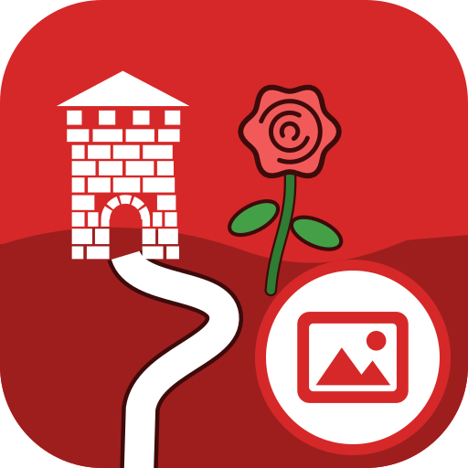

<h1 align="center">Rosenweg Galerie</h1>

Galerie für die Smartphones der Siedlung Rosenweg – Bilder vom Telefon und Fotos und Videos aus der eigenen Rosenweg-Nextcloud.

<a href="https://www.rosenweg4303.ch/apps">Herunterladen</a> · <a href="docs/anleitung.md">Anleitung</a> · <a href="docs/entwickeln.md">Für Entwickler</a>

## Was die App kann

- Fotos und Videos vom Telefon und aus der Nextcloud ansehen – auch das, was Rosenweg Kamera hochgeladen hat.
- Bilder bearbeiten; das Ergebnis kommt als neue Datei neben das Original.
- Umbenennen und Löschen wirken direkt auf die Datei in der Nextcloud.
- Zeigt an, wenn noch Kamera-Uploads warten.
- Einstellungen gehören der Person und sind auf jedem Telefon wieder da.

## Plattformen

Android.

## Entwickeln

Android-App (Kotlin) auf Basis von Fossify Gallery, gebaut gegen
[commons-rosenweg](https://github.com/Rosenweg/commons-rosenweg): `./gradlew assembleFossRelease` –
Bau, Signatur, Logo und Veröffentlichung stehen in [docs/entwickeln.md](docs/entwickeln.md).

## Herkunft und Lizenz

Basiert auf [Fossify Gallery](https://github.com/FossifyOrg/Gallery) – herzlichen Dank an das Fossify-Team und alle Mitwirkenden.
GPL-3.0, siehe [LICENSE](LICENSE).
